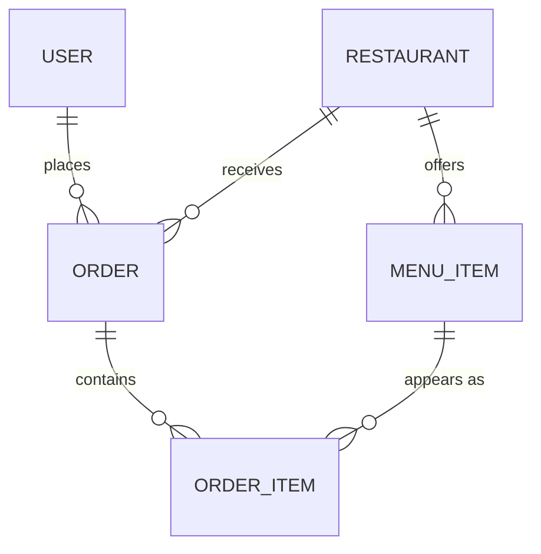

<h1 align="center">The Card</h1>

<p align="center"><b>Scan the QR code on your table. The menu is already open. So is the bill.</b></p>

<p align="center">
  
  
  
  
  
  
</p>

<p align="center">
  
  
  
  
</p>

<p align="center"><sub>🎓 Le Wagon full-stack bootcamp · 2021 · Weeks 8–9 · Final project</sub></p>

---

## The idea

Waiting to order is the worst part of eating out. A printed menu, a wave at a passing waiter, another wait for the bill.

**The Card** replaces that with a QR code on the table. Scan it, and you are looking at that restaurant's menu on your own phone. Build the order, send it, keep adding through the meal, pay when you are done. The waiter brings food instead of taking notes.

## The domain

The whole project is really one modelling question: *what is an order, before it is paid for?* The answer shapes everything else.



An `Order` is a live basket that belongs to a table, not a receipt. `OrderItem` is the join between an order and a menu item — and it carries its own state, because "two of these, no onions" is information that belongs to neither side alone. That distinction is what makes an order editable mid-meal instead of final at the moment it is sent.

## What was built

| | |
|---|---|
| 🔐 **Accounts** | Sign-up, sign-in, password reset and confirmation flows via Devise |
| 🍽️ **Restaurants & menus** | Each restaurant owns its menu items; a customer browses one restaurant at a time |
| 🧾 **Live orders** | Add, change and remove line items while the order stays open — `create.js.erb` updates the cart without a page reload |
| 💳 **Order lifecycle** | Dedicated `stashed` and `paid` states, so an order has a life beyond "exists" |
| 📱 **QR-code entry** | `rqrcode` generates the code that puts a table straight into the right restaurant |
| 👆 **Touch-first UI** | A swipe bar and floating action elements — built for a phone held one-handed at a table |

```ruby
resources :restaurants, only: [:show, :new, :create] do
  resources :menu_items, only: [:show, :index]
end
resources :orders, only: [:index, :show, :new, :update] do
  resources :order_items
end
get 'paid',    to: 'orders#paid'
get 'stashed', to: 'orders#stashed'
```

Nested routes that read like the domain: a menu item belongs to a restaurant, a line item belongs to an order.

## How it was built

**A team of five, 266 commits, 121 merged pull requests, 23 days.**

| | |
|---|---|
| 📅 **23 Aug – 14 Sep 2021** | The full final-project sprint, start to demo |
| 🔀 **121 merged pull requests** | Nothing went to the main branch directly — every change was branched, opened and reviewed |
| 👥 **5 contributors** | Louis Neubauer · Janus Vollmer · Max Eduard von Wedemeyer · Marcel Fonseca · Oscar Sodian |
| ✍️ **75 commits from me** | The largest single share, across the schema, orders and the ordering flow |

That pull-request count is the part worth noticing. Five people nine weeks into
learning to code could have taken turns pushing to `main` and spent the last
three days untangling it. Branching every change and reviewing it was slower on
day one and the reason the thing worked on day twenty-three.

## Why it still matters

This was the first time everything had to work at once — authentication, a
non-trivial schema, nested resources, asynchronous updates, an external library,
a design meant for a thumb rather than a mouse, and four other people changing
the same files.

It was also written in **2021, by hand.** No assistant, no autocomplete worth the
name. Every bug was read, traced and fixed by someone who had to understand it
first — and every merge conflict resolved by someone who had to understand both
sides.

**That is the whole reason it is kept.** The AI tooling I build with now is only
as good as the review it gets, and you cannot review what you never learned to
read.

## Stack

`Ruby on Rails 6` · `Ruby` · `PostgreSQL` · `Redis` · `Devise` · `rqrcode` · `simple_form` · `Webpacker` · `SCSS`

---

<p align="center">
  <sub>Final project of the 2021 Le Wagon full-stack bootcamp — built with<br>
  Janus Vollmer, Max Eduard von Wedemeyer, Marcel Fonseca and Oscar Sodian.<br>
  For what I build now, see <a href="https://github.com/LouisNeubauer">my profile</a>.</sub>
</p>
